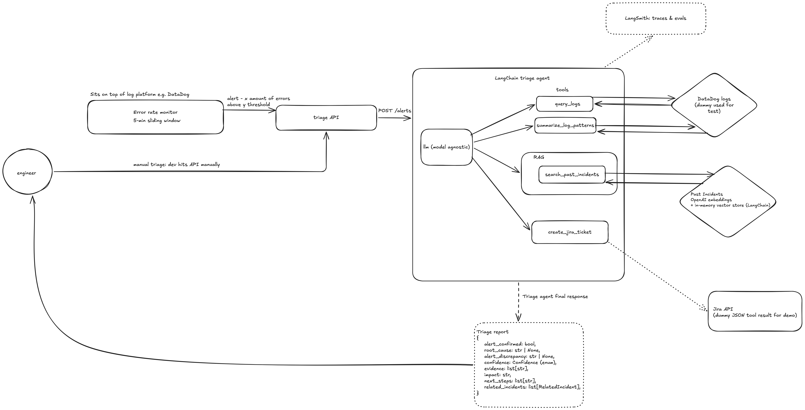

# Incident Triage Agent

A LangChain agent that triages production alerts by investigating Datadog-style logs, checking past incidents, and filing a Jira ticket. LangSmith handles tracing and evaluation.



- **Screen recording: please find screen recording in the submission folder.
- **EDD Example** [before and after](docs/FINDINGS.md#before-and-after), and known failures and limitations in [docs/FINDINGS.md](docs/FINDINGS.md)

## Quick start

```bash
make setup    # uv sync, create .env from sample.env
# add ANTHROPIC_API_KEY / OPENAI_API_KEY to .env
make triage   # run the agent on the default alert
make test     # unit tests, no keys or network needed
```

Configuration lives in `.env`; see `sample.env` for every variable. For LangSmith tracing, set `LANGSMITH_TRACING`, `LANGSMITH_API_KEY`, `LANGSMITH_AGENT_ID` and `LANGSMITH_AGENT_ENVIRONMENT`. Don't also set `LANGSMITH_PROJECT`: with both set, nothing is traced.

## Viewing traces locally

Every run from the CLI, the API, the UI and the evals is traced to LangSmith once tracing is on. In `.env`:

```bash
LANGSMITH_TRACING="true"
LANGSMITH_API_KEY="<your key>"
LANGSMITH_ENDPOINT="https://eu.api.smith.langchain.com"   # or https://api.smith.langchain.com for a US account
LANGSMITH_AGENT_ID="triage-agent"
LANGSMITH_AGENT_ENVIRONMENT="local"
```

Run a triage (`make triage`, or the Triage tab in `make ui`), then open LangSmith for your region ([eu.smith.langchain.com](https://eu.smith.langchain.com) or [smith.langchain.com](https://smith.langchain.com)). The run shows up under the `triage-agent` agent in the `local` environment. Each trace is a tree of model calls and tool calls, showing the exact arguments, each tool's result, tokens and latency, and ending with the `TriageReport`.

Eval runs go to LangSmith as experiments. Under **Datasets & Experiments**, open the `incident-triage-evals-…` dataset, then select two experiments and click **Compare** to see baseline and RAG side by side, one case per row. `make eval` prints a direct link when it starts. The unit tests never send traces (`tests/unit/conftest.py` turns tracing off).

## How it works

The agent is `create_agent(model, tools, system_prompt)` and finishes by returning a structured `TriageReport`. Its tools:

| Tool | Purpose |
| --- | --- |
| `query_logs` | Search logs by time window, service, status and text |
| `summarize_log_patterns` | Group every service's logs in a window into message templates with counts |
| `search_past_incidents` | Semantic search over past tickets (RAG), returning confirmed root causes and fixes |
| `create_jira_ticket` | File one ticket per alert in a dummy Jira project; rejects customer emails |

Design notes and gotchas found along the way are in [docs/FINDINGS.md](docs/FINDINGS.md).

## Running it as a service

```bash
make serve     # triage API on localhost:8000
make monitor   # replay the log archive through the error-rate monitor, which posts alerts to the API
make triages   # see what the agent concluded
```

The API (`POST /alerts`, `GET /triages`, `GET /triages/{alert_id}`) queues triages in the background and is idempotent on alert ID. The monitor (`src/monitor/`) fires when a service's error rate passes 5% with at least 10 errors over 5 minutes, and stays quiet until the service recovers.

## In production

This repo uses stand-ins so it runs without any accounts beyond the model and LangSmith keys: generated logs, a replayed monitor, a dummy Jira file and in-memory stores. A real deployment replaces them:

| Part | In this repo | Real deployment |
| --- | --- | --- |
| Logs | A generated archive (`data/datadog_logs/`) | Real Datadog logs, queried through the Datadog Logs Search API. The tools already return that API's response shape. |
| Alerts | `src/monitor/` replaying the archive | Most likely Datadog's own monitors, sending a webhook to the triage API |
| Triage API | `make serve` on localhost | A hosted service |
| Queue | FastAPI background tasks and an in-memory store | Redis, so queued triages survive restarts and several workers can share the load |
| Past incidents (RAG) | An in-memory vector store, embedded at startup | A hosted vector database, for example on AWS, updated as tickets are resolved |
| Tickets | A dummy Jira file, for the demo | The real Jira API |

Running locally doesn't change the integrations. The CLI would read the same Datadog logs, search the same hosted vector database and file into the same Jira project as the hosted service; only the API and its Redis queue run server-side. It stays a developer tool: when an engineer picks up a ticket the agent filed, they can rerun the triage locally against the same alert and read the trace in LangSmith to see how the agent reached its conclusion. The rerun should use the original alert's ID, so the one-ticket-per-alert rule returns the existing ticket instead of filing a duplicate.

### Evaluating in production

The evals would run regularly, in two ways:

- **Online:** a sample of real alerts, for example 10%, is scored as it's triaged. Real alerts have no expected answer, so this uses the checks that don't need one (a report was produced, no customer emails, cited tickets exist, the reported ticket key matches the one filed) and the LLM judge, which is reference-free by design.
- **Offline:** the full eval dataset is rerun to catch regressions whenever the agent changes (prompt, tools, model) or the services it watches change, for example when a new type of error starts appearing in the logs. A change like that also gets new cases in the dataset.

Scores, judge reasoning and traces are tracked in LangSmith in the same way as in this repo.

## Evals

```bash
make eval ARM=baseline   # agent without past-incident search
make eval ARM=rag        # agent with it
```

Eight cases in `data/evals/triage_cases.json` cover correct, vague, wrong and false-alarm alerts. Each run is scored by deterministic checks (`src/evals/evaluators.py`) and a reference-free LLM judge (`src/evals/judge/`); summaries are written to `eval_results/`. Use `--skip-judge` for a cheap run.

Half the cases have an alert that is wrong (wrong service, wrong start time, wrong cause, or no incident yet), because an agent that believes the alert is the main risk. Each case has an "as of" time and the agent only sees logs before it. Deterministic checks cover anything with a known answer: the alert verdict, root-cause terms, the red herring being ruled out, whether a ticket was filed, PII, and whether cited tickets exist. The judge covers what needs judgment: whether the report is grounded in the tool results, whether the confidence is justified, whether the next steps are usable, and whether an on-call engineer could rely on it. It doesn't see the expected answer, so it can also score live traffic.

To calibrate the judge against your own labels:

```bash
make judge-labels EXPERIMENTS="triage-baseline-<id> triage-rag-<id>"
make ui                # label reports in the "Label reports" tab
make calibrate-judge   # agreement per criterion
```

## Demo UI

`make ui` starts a Gradio page on localhost:7860 for watching a triage stream in.

## Mock data

`make logs` regenerates `data/datadog_logs/` deterministically. The one scenario, `payment_service_bad_deploy`, has five services on 2026-11-17 from 01:45 to 02:30 UTC: payment-service v2.14.0 rolls out at 02:05, breaks checkout from 02:09, and inventory-service DB timeouts run throughout as a red herring. Past incidents for retrieval are hand-written in `data/incidents/past_incidents.json`.

## Use of a coding assistant

Submission completed using Claude Code. I instructed the agent the rules and parameters that I would like the project to be built upon, which was then added to AGENTS.md. This includes:
- a TDD-first approach to writing code
- ensuring unit test assertions are written uniformly, using full objects
- code must be modularised, to simulate a scalable codebase
- data structures must be typed
- Errors must be handled gracefully or raised, and not avoided via defensive code. (This is a common drawback I often find when using coding assistants)

From there, we worked in tandem to produce the final product.
